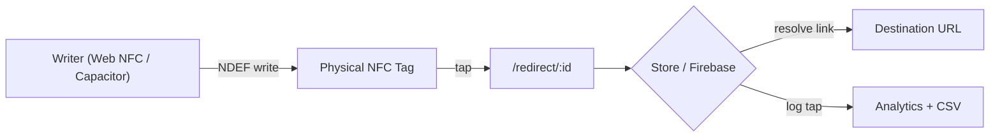

# Tocaito — NFC Tag Manager

[](https://nfc.novu.works)


**Tocaito** is a cross-platform app for **writing, managing, and tracking NFC tags** at events and on physical touchpoints. Every tag points to a **dynamic redirect**, so its destination can change at any time without rewriting the chip. Each tap is recorded for analytics.

It runs as an installable **PWA** (Web NFC on Android Chrome) and as a **native iOS app** through Capacitor, from one Vite codebase.

> **▶ Live demo:** **[nfc.novu.works](https://nfc.novu.works)** · Part of the [NovuWorks portfolio](https://novu.works)

---

## Features

| Module | Capabilities |
| --- | --- |
| **Tag Writer** | Write NDEF URL records through Web NFC (`NDEFReader`) or native NFC (`@capgo/capacitor-nfc`), with a guided flow for iOS |
| **Dynamic Redirects** | Tags point to a stable redirect URL; reassign the destination link at any time |
| **Links & Tags** | Full CRUD for links and physical tags, plus reusable **templates** |
| **Analytics** | Tap tracking, a dashboard view, and **CSV export** |
| **Admin & Security** | PIN-protected admin (SHA-256 hashed), Google Sign-In through Firebase Auth, and **biometric unlock** on native |
| **Native extras** | Haptic feedback, geolocation-tagged taps, and persistent preferences |
| **i18n** | Built-in internationalization layer |
| **Offline-ready** | Service worker and web app manifest for an installable PWA |

## Architecture



- **Framework-free SPA:** a hand-built hash router (`src/router.js`) with per-view cleanup, plus modular views and components
- **State:** a central store (`src/store.js`) persisted locally and synced with Firebase
- **Security:** input sanitization and XSS hardening (`src/utils/sanitize.js`, `src/utils/security.js`) with dedicated test coverage

## Tech Stack

- **Frontend:** Vanilla JavaScript (ES modules), Vite 7, modular CSS design tokens
- **Mobile:** Capacitor 8 (iOS): NFC, Haptics, Geolocation, Preferences, Native Biometric
- **Backend:** Firebase (Auth, Hosting, data)
- **Quality:** Node's built-in test runner (`node --test`) for store and security tests, plus **Python + Playwright** end-to-end verification scripts that record video and screenshots

## Getting Started

```bash
git clone https://github.com/eresfavolosx/NFC.git
cd NFC
npm install
npm run dev        # http://localhost:5173
npm test           # unit + security tests
npm run build      # production bundle in dist/
```

### Native iOS build

```bash
npm run build
npx cap sync ios
npx cap open ios   # build & run from Xcode on an NFC-capable iPhone
```

### End-to-end verification

```bash
pip install playwright && playwright install chromium
python verification.py
```

## Project Structure

```text
src/
├── main.js            # App bootstrap, auth & biometric gate
├── router.js          # Hash router
├── store.js           # State + persistence (+ store.test.js)
├── nfc.js             # Web NFC + Capacitor NFC abstraction
├── firebase.js        # Firebase init
├── i18n.js            # Translations
├── components/        # header, sidebar, modal, toast
├── views/             # dashboard, writer, links, tags, templates,
│                      # analytics, admin, settings, profile, login, redirect
└── utils/             # sanitize, security helpers
tests/                 # Node test runner suites
verification/          # Playwright E2E artifacts
ios/                   # Capacitor native iOS project
```

## Author

**Fabián Vélez Vicente**: [novu.works](https://novu.works) · [GitHub @eresfavolosx](https://github.com/eresfavolosx)
